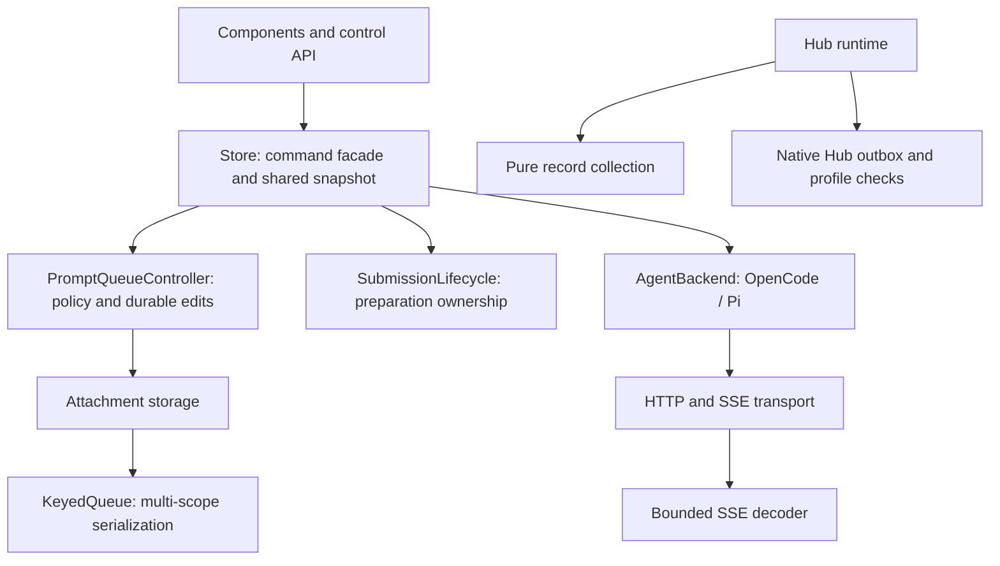

# Reliability and architecture audit — 2026-10-14

Scope: desktop TypeScript/React, native Rust, bundled browser/shared adapters,
Hub, tests and CI. Preserve application identity, stored histories and queues,
OpenCode/Pi contracts and the installed runtime. Tests use isolated data and no
model inference. An audit can establish tested guarantees, not prove the absence
of every possible defect.

## Work and acceptance

1. Establish a baseline and inspect lifecycle/storage/transport boundaries.
2. Reproduce and fix confirmed races and failure handling, retaining uncertain
   delivery protection and explicit permissions.
3. Move cohesive responsibilities out of the store into independently testable
   modules; keep a stable facade and one source of application state.
4. Address native diagnostics and make architecture/static checks repeatable in
   CI. Review bundled runtime and Hub separately from the UI.
5. Run all affected regression suites, frontend build, native checks/tests,
   Hub/runtime checks and a separate diff review. Record actual coverage and
   remaining limitations. Do not reinstall or launch owner jobs during the audit.

## Baseline

- Source: `745790133a5da7cfc5ea32506d4b98068e215148`, clean `main`.
- Frontend: 753 passed, 6 pre-existing skipped tests.
- Hub: 37 passed.
- Production npm dependencies: no reported advisories at audit time.
- Strict Clippy: 14 diagnostics (not currently enforced in CI).
- Store: 3,584 lines, connection/session/queue/dispatch ownership intertwined.

## Findings and verification

### Corrected failure modes

| Boundary | Failure | Result |
| --- | --- | --- |
| Attachment storage | Opposite-direction copies waited on each other; move/add could overwrite the destination cache | Reserve both scopes before awaiting either operation; cache and IndexedDB stay consistent |
| Attachment limits/recovery | Move bypassed capacity limits; one failed database open poisoned later operations | Validate the destination before commit; retry a failed/closed IndexedDB connection |
| Manual submission | Stop or an away/back navigation during preparation still permitted a POST | Explicit preparation ownership and cancellation; stale completion cannot unlock another submission |
| Acknowledgement | Cancelling preparation must not discard an already dispatched request | A POST retains acknowledgement/cleanup ownership; no automatic replay |
| Durable queue | A failed preferences write cleared the text draft and armed a non-durable item | Commit before publishing/removing drafts; failure keeps the original draft and queue |
| Queue preparation | Returning to the same chat could revive an obsolete preparation | Selection generation invalidates the entire away/back cycle; item remains ready for explicit recovery |
| Scheduled dispatch | Cancellation during model readiness could still send; readiness failure was treated as uncertain delivery | Re-check cancellation/Stop and authoritative blockers after readiness; delivery starts only at POST |
| SSE lifecycle | Buffered events survived cancellation; an idle reader could remain locked | Stop delivery immediately and cancel/release the reader on every exit |
| SSE reconciliation | Subscriber exceptions and malformed JSON could silently lose state | Report the failure and reconnect; do not include raw event payload in the error |
| SSE backoff/framing | Repeated successful HTTP headers with immediate EOF reset backoff; framing needed a per-event bound | Healthy-duration reset, bounded reconnect and incremental LF/CRLF/CR framing |
| HTTP response body | Body cancellation/timeout was labelled malformed JSON | Distinguish transport/cancellation from actual JSON syntax errors |
| Voice/workspace isolation | Two SSH tunnels could reuse an endpoint and misroute late dictation | Bind dictation to stable workspace identity |
| Hub metrics | Native spool removed the diagnostics calculated by the UI | Preserve a strict numeric-only diagnostics schema; reject unknown/private payload fields |
| Hub collection | Unknown background-chat metadata inherited the foreground directory | Collect known metadata from one snapshot; defer unknown sessions |
| Hub profile changes | A collected batch could enter another profile's outbox; a downloaded skill could be marked installed under another Hub | Bind enqueue/download/registration to the original Hub, recheck after asynchronous work, preserve configuration CAS |

The first regression run failed eight attachment/transport tests against the old
code. Separate runs reproduced three submission/storage failures, scheduled
cancellation, two native diagnostics failures and the cross-Hub package race.
Additional regression tests cover related cancellation, recovery and scope
boundaries. The final frontend suite adds 29 passing tests to the baseline.

### Architecture

The facade and stored formats remain compatible. Controllers access one state
snapshot through a typed port; they do not own duplicate application state or
start another agent loop. Pure engine IDs no longer pull concrete backends into
selectors. Native skill scanning and Hub record preparation have their own
modules. The store shrank from 3,584 to 3,371 lines; connection/session orchestration
still belongs there. This is a boundary refactor, not a claim that every old
module was rewritten.

`npm run check:architecture` checks 143 TypeScript modules for runtime cycles and
reverse dependencies from low-level modules into UI/control/store. It is now a CI
gate. CI also installs Clippy and rejects native warnings on all targets. The
14 original diagnostics were addressed; the ASR command has one documented,
narrow argument-count exception to preserve its released IPC signature.

The development lockfile advances `source-map-js` from 1.2.1 to 1.2.2, addressing
[GHSA-68fv-2mgg-jv7q](https://github.com/advisories/GHSA-68fv-2mgg-jv7q).
Production dependencies did not have a reported advisory in the baseline.

### Final evidence

| Check | Result |
| --- | --- |
| `npm test -- --maxWorkers=2` | 782 passed, 6 pre-existing opt-in skips; 104 files passed, 2 skipped |
| `npm run build` | TypeScript and production Vite build passed |
| `npm run check:architecture` | 143 modules, no runtime cycles/reversed dependencies |
| `cargo clippy --locked --manifest-path src-tauri/Cargo.toml --all-targets -- -D warnings` | Passed on macOS |
| `cargo test --locked --manifest-path src-tauri/Cargo.toml` | 107 passed, 1 existing OS-vault opt-in ignored |
| `cargo fmt --manifest-path src-tauri/Cargo.toml -- --check` | Passed |
| `python3 -m unittest discover -s services/hub/tests` | 37 passed |
| `node --test src-tauri/resources/browser/test/evaluate-result.test.mjs` | 2 passed |
| `npm run eval:check` | All 12 reference fixtures pass and their defective baselines fail; no model calls |
| `npm audit --json` | 0 reported vulnerabilities including development dependencies |
| Bundled browser/shared dependency audit | 0 reported vulnerabilities |
| Real Chromium queue UI | ZIP removal, editing and Now delivered the intended prompt exactly once; supported 900×620 minimum window fits |
| Real isolated browser daemon | 36 tools; auth/origin checks, DOM/manual input, upload, workspace isolation, persistent profile restart, human mode, resize/scroll recovery and sequence interruption passed |
| Final source review / `git diff --check` | Passed |

Browser tests used disposable profiles/local fixtures and the installed Chromium
binary read-only. Owner tabs, providers, running sessions, Hub data and GPU
services were not used or changed. Local receipts are under
`.local/refactor-20261014` and `/tmp/arvela-refactor-*`; these private artifacts
are excluded from source control.

### Coverage limits

- The installed app was not replaced. Native GUI packaging, macOS vault prompts,
  Windows/Linux live acceptance and actual model/provider calls were not run.
- Existing opt-in tests remain opt-in. Passing fixtures are not a measured model
  quality or speed improvement.
- Vite still reports existing bundle-size/mixed dynamic-import warnings. These
  are not suppressed or claimed resolved by this reliability refactor.
- The architecture gate covers TypeScript runtime imports. It does not verify
  arbitrary runtime IPC behavior, every Rust module relationship or plugin code.
- No finite review establishes absence of all possible bugs. The guarantees above
  are tied to the listed scenarios; future platform/provider changes still need
  acceptance and monitoring.
